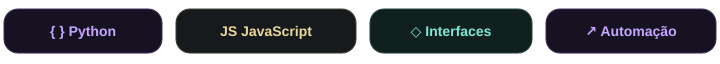
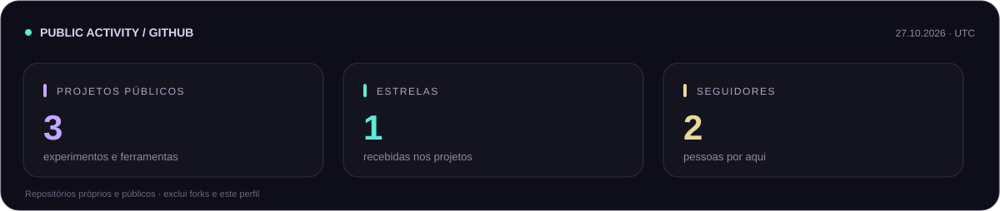

  

  <b>Ideias viram código. Código vira ferramenta.</b> 
  Crio soluções para simplificar processos e dar mais espaço à criatividade.

  <picture>
    <source media="(max-width: 520px)" srcset="assets/stack-mobile.svg" />
    
  </picture>

### 🐈‍⬛ Por aqui

Gosto de conectar peças: uma interface clara, um processo bem organizado e uma automação que resolve o trabalho repetitivo. Meu foco é construir ferramentas úteis, testar na prática e melhorar a cada versão.

<table>
  <tr>
    <td width="50%" valign="top">
      <b>⚡ Automatizar o que se repete</b>  
      Ferramentas, integrações e fluxos que economizam cliques e tempo.
    </td>
    <td width="50%" valign="top">
      <b>🎬 Criar com menos atrito</b>  
      Interfaces e soluções que aproximam tecnologia e produção criativa.
    </td>
  </tr>
</table>

### 📡 Meu espaço no GitHub

  <picture>
    <source media="(max-width: 520px)" srcset="assets/pulse-mobile.svg" />
    
  </picture>

Dados públicos · atualização diária pelo GitHub Actions

### 🧪 Laboratório público

Alguns dos meus experimentos abertos:

| Projeto | Tecnologia | Repositório |
| :--- | :--- | :--- |
| 🤖 **bot.minecraft.kgd** | JavaScript | [Explorar →](https://github.com/kingblackcatt/bot.minecraft.kgd) |
| 🛠️ **serverrr2** | JavaScript | [Explorar →](https://github.com/kingblackcatt/serverrr2) |
| 🏍️ **motoproject** | HTML | [Explorar →](https://github.com/kingblackcatt/motoproject) |

  <a href="https://github.com/kingblackcatt?tab=repositories">Ver todos os projetos públicos ↗</a>

  

